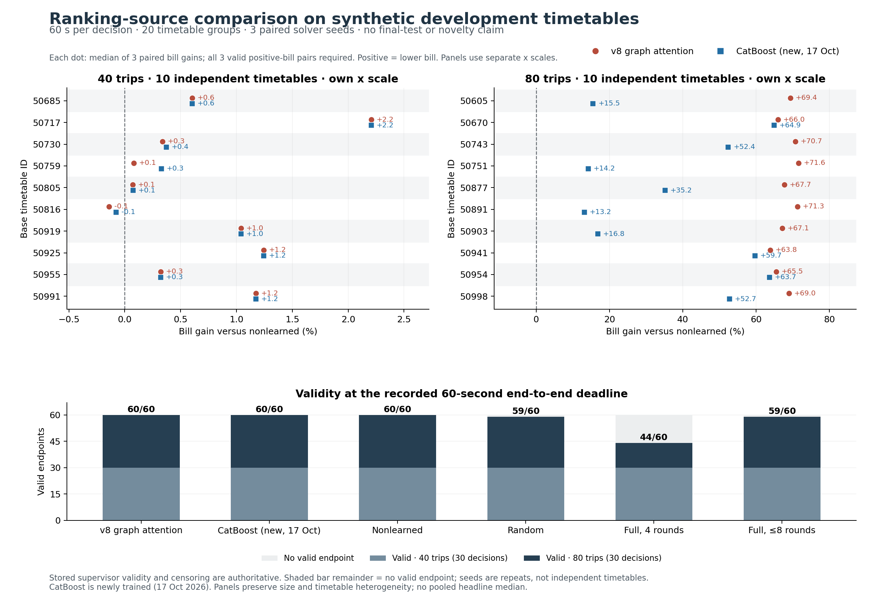

# EGG: independent-review handoff, 17 October 2026

## Decision requested

Please assess whether the learned connection-ranking approach merits the next recovery/model-development study, and identify the strongest alternative explanation for the observed gains. We have stopped at a complete comparative development study. All 360 registered decisions finished; no further experiment is being launched and scheduled continuation is paused. This package is a research-state review, not a submission-ready manuscript or a claim that the predictor is finished.

## Main result

A fixed graph-attention ranker (v8, task00) improved replay-valid bills over the prespecified cheap nonlearned ranking, with a large size dependence:

| Comparison | 40 trips: median group gain | 80 trips: median group gain |
|---|---:|---:|
| Graph attention versus nonlearned ranking | 0.47% | 68.36% |
| New CatBoost versus nonlearned ranking | 0.49% | 43.82% |
| Graph attention versus random ranking | 29.76% | 19.37% |
| Graph attention versus CatBoost | approximately 0% (-0.002%) | 44.37% |

Positive gain means a lower bill for the first method. First compute a paired relative bill difference within timetable/solver seed; take the median of available positive-bill seed pairs within each timetable, then the median across the ten timetable groups of each size. The random comparison has 59 both-valid pairs overall; the other comparisons in this table have 60. CatBoost-versus-nonlearned gains are computed directly, not by combining the graph comparison percentages.

The prespecified pooled graph-versus-nonlearned median is 33.03%, but it sits between sharply different size regimes. It is not a representative gain for either size and should not be the headline. These are finite-budget differences in feasible plan bills, not gaps to known optima. The worst paired regression for graph attention versus nonlearned was about 0.32%; nine of ten 40-trip groups and all ten 80-trip groups had positive median gain.

| Method | Valid decisions / 60 | Other outcomes |
|---|---:|---|
| Graph attention | 60 | — |
| New CatBoost | 60 | — |
| Nonlearned ranking | 60 | — |
| Random ranking | 59 | 1 extraction/replay-related unresolved outcome |
| Unpruned, four-round control | 44 | 16 no-plan outcomes |
| Unpruned, historical eight-round-cap control | 59 | 1 deadline-censored outcome |

A no-plan outcome is not a mathematical infeasibility result. The censored control is retained, not silently dropped. Conditional bill comparisons must always retain their valid-pair denominators.

## What was held fixed

Twenty distinct synthetic base timetables, ten each at 40/80 trips; each base appears at only one size. Three paired solver seeds (17, 41, 73), six arms, 60 seconds end-to-end per decision on the same Mac/Gurobi backend. Two concurrent single-thread workers; arm order was interleaved/rotated. Startup, scoring, model construction, integer search, charging completion, replay and result materialization all consume the decision allowance.

All four ranking arms used the same global 30% plus top-three incoming/outgoing coverage rule and mandatory pullouts/pullins. Actual retained cardinalities differ slightly because coverage is a union: at 80 trips, median kept movement counts were 1959.5 (graph), 1961 (CatBoost), 1964.5 (nonlearned) and 1977 (random), versus 6157 full movements. This supports a common-policy comparison; it is not an exact constant-cardinality causal comparison.

The nonlearned score was frozen before outcomes: minus moving-leg minutes, minus 0.1 times intertrip gap, plus 0.1 times depot dwell. It is one inexpensive heuristic, not an exhaustive state-of-the-art nonlearned baseline. The two unpruned controls distinguish the four-round search schedule from the earlier full-budget/eight-round-cap policy. They do not establish that every unpruned optimization strategy would perform similarly.

## Models, labels and physical trust

The graph arm used one previously selected model; it is not a twelve-model ensemble. The new CatBoost comparator used the admitted 128-group TRAIN bank and the same 80-fit / 16-inner / 32-historical-outer split. Candidate choice and stopping used inner groups only. CatBoost selected depth 6 and 266 trees. A logistic baseline was also trained but was not an arm of this downstream study. Classical training took 20.69 seconds; its classification metrics alone are not a routing result.

Labels identify edges in observed feasible source incumbents, not unique or proven optimal routes. New timetable seeds do not remove the generator's shared physical profiles or all distribution overlap. The study used one day tariff and a synthetic population; no final sealed evaluation or new public-network generalization was performed. Sealed DEV/TEST/A6/B3/confirmation/GIRO remained unopened. Generic learned/GNN connection pruning is established prior art; this study does not create a novelty claim for it.

The common solver path now optionally qualifies routing decisions and completes charging with routes fixed. It preserves independently replay-valid raw plans if completion fails and retains the best true-bill candidate across rounds. Original MIP bounds remain separate from fixed-route LP objectives. A failed first qualification exposed timing/finalization issues; its evidence is preserved. Corrected qualification passed before the substantive screen. Independent full-case replay, numeric-witness exact billing and solver certification remain distinct claims.

## Questions for the reviewer

1. Is the inexpensive nonlearned ranking too weak? Which charging-aware heuristic, LP-based ranking or solver-native control should be the next decisive comparator?
2. Is the 80-trip gain evidence of useful route knowledge, or mainly a consequence of this generator, the retention policy and short solver horizon? How should we test the size transition and physical/tariff shifts?
3. Does graph attention earn its extra complexity over CatBoost? They essentially tie at 40 trips and diverge at 80; which ablation would best explain that difference?
4. Are replay, incumbent retention, clock measurement, missingness and bound provenance convincing? Which remaining numerical failure mode deserves priority?
5. Should we next restore all pruned connections after acquiring a valid plan, improve labels/ranking losses, or broaden the data first? What evidence would justify a journal-level contribution beyond known pruning methods?

## Evidence and status

Start with `INDEPENDENT_SCREEN_CHECK.md`, the figure's `per_group.csv` / `per_cell_endpoints.csv`, the frozen `LOCAL_CAMPAIGN_PROTOCOL.md` / `LOCAL_CAMPAIGN_MANIFEST_V3.json`, and `LOCAL_MONITORING.md`. Full per-decision accounting is in the compact review bundle; original native traces and solver diagnostics remain preserved locally and are identified by hashes. Model/source/case hashes are in `local-assets-v3.json`; source code is on branch `codex/ml-prediction-20261017` of `ndandnd/egg`.

The final analyzer is `screen-analysis-v3-final/summary.json`; all 15 prospective gates pass. Its computed “GO” means eligibility for a separately frozen recovery study, not a launch: the user has requested an independent review first. `INDEPENDENT_SCREEN_CHECK.md` confirms the numerical comparisons without disagreement. The screen used 3.72 CPU hours including its supervisor, within the eight-hour ceiling; closeout/audit accounting is reported separately in `CLOSEOUT_ACCOUNTING.json`.

`FINAL_REPLAY_VERIFICATION.md` independently replays all 342 supervisor-valid plans on their original full cases and recomputes exact bills: all 342 pass, with zero mapping, replay, bill or stored-projection mismatches. The 18 excluded endpoints retain their original status. An earlier postprocessing output-folder collision is preserved under `screen-analysis-v3`; no experiment was rerun or modified.

`REVIEW_BUNDLE_20261017.zip` provides the compact receipts, physical plans/replays, models, frozen sources, protocols, figures and audit scripts. Its manifest lists byte hashes. Original 12 GB native traces remain local and are covered by the final analysis hash manifest; raw solver stdout/stderr are excluded from the public bundle. The bundle is for evidence review; replay and solve reproduction on another machine require adapting the original absolute paths while retaining byte-identity checks.

Recovery currently exists as a reviewed contract and pure replay/mapping prototype, with eleven handcrafted tests. It has not been integrated into the optimizer or run as an experiment. Restoring connections can split charging intervals, so the design uses movement IDs for binary hints and retains an independently replayed physical fallback. Retention cannot worsen the same acquired prefix witness; it does not guarantee beating a static solve given the whole allowance.
