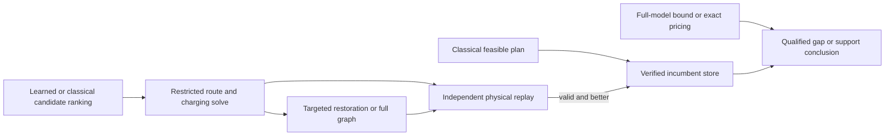

# What EGG can borrow from other fields

**23 October 2026 — Google Scholar and primary-paper review.** This report integrates electric-bus scheduling, power-system optimization, chemistry, quantum algorithms, biological networks, control, robotics, sparse optimization and verification. Three GPT-6.1 Sol researchers prepared separate reviews; the parent checked additional sources and integrated a skeptical internal challenge. The package contains **41 core paper/record entries** across the four main reviews and two follow-up notes, plus explicitly marked additional leads. These are not 41 independent research lines or 41 fully audited proofs. Seven actual Google Scholar searches succeeded in the browser; targeted web searches and primary references supplied further sources. Access depth varies and is recorded in [SEARCH_LEDGER.md](SEARCH_LEDGER.md).

## Main judgment

The search supports a more specific research direction: **learn which alternatives deserve expensive joint optimization, while preserving valid plans and measuring what remains unverified.** The value must come from identifying useful alternatives under charging and power coupling—not merely from making a large model smaller.

Three findings change our next steps:

1. **The immediate novelty boundary is tighter.** Learned bus-connection pruning is established, a 2026 conference abstract explicitly describes progressive restoration, and nonlearned GRASP-based reduction is a serious competitor. Generic recovery cannot carry the contribution. [Gerbaux et al. 2025](https://doi.org/10.1016/j.cor.2024.106848), [Olson et al. 2026](https://orbit.dtu.dk/en/publications/graph-neural-network-enhanced-column-generation-for-electric-bus-/), [Montanaro et al. 2025](https://doi.org/10.1007/978-3-031-95976-9_7).
2. **Better labels may matter more than another network.** One incumbent demonstrates one good combination; it does not establish that unused edges are bad. Biology's alternative-solution analysis supplies a useful way to distinguish essential, optional, excluded and unresolved choices. [Mahadevan & Schilling 2003](https://pubmed.ncbi.nlm.nih.gov/14642354/).
3. **Chemistry suggests a better selection target.** Current-solution-dependent ranking and coordinated expansions are more promising than permanently assigning each edge a usefulness score. This is a design hypothesis for EGG, not a transferred performance guarantee. [Coe 2018](https://arxiv.org/abs/1808.05787), [Nie et al. 2026](https://doi.org/10.1021/acs.jctc.6c00937).

The present EGG screen cannot resolve these questions. At 80 trips, 91.916% of **summed paired** graph-versus-heuristic savings is vehicle-count cost; this is not a decomposition of the 68.36% median group gain. The dominant demonstrated benefit is finding fewer-bus plans within a short budget. At 40 trips fleet counts match, but routing energy can still confound tariff responsiveness. See the existing [mechanism analysis](../bill-mechanism/RESULTS.md). No new numerical result was generated by this review.

## The shared problem, expressed without domain jargon

A cheap predictor chooses a small subset of possibilities. An expensive optimizer determines whether they combine into a good feasible solution. The choices interact, so local scores can be misleading. Expanding the subset can recover a missed solution, but uses time that could instead improve the current solution or prove a bound.

| Field | Similar question | Useful transfer to EGG | Boundary |
|---|---|---|---|
| Selected configuration interaction, chemistry | Which states should enter an otherwise enormous calculation? | Re-score omitted candidates after solving; separate generation, retained-set and audit budgets. | Quantum energy corrections are not bus optimality bounds. |
| Metabolic network reconstruction | Which missing reactions restore function, and which reactions vary across equally good states? | Minimum-addition repair; multiple witnesses; objective-band labels. | Continuous flux conservation does not imply integral route feasibility. |
| Predictive safety filtering and learning MPC | Can a learned proposal improve behavior without losing an available safe continuation? | Retain and independently verify a complete fallback. | Recursive safety is not deadline performance or dominance over another solver. |
| Task-and-motion planning | Which symbolic plan merits an expensive continuous feasibility check? | Lazy completion checks, caching, active learning of plan-level feasibility. | A timeout is unknown, not an infeasibility label. |
| Sparse optimization | Which variables can be omitted without changing the answer? | Separate heuristic restriction from bound-certified deletion. | Convex screening theorems need assumptions absent from a general fleet MILP. |
| Formal verification | Which counterexample reveals an inadequate abstraction? | Let failures trigger targeted refinement and tests. | Behavior overapproximation and feasible-plan restriction have opposite proof directions. |
| Unit commitment and contingency screening | How can learning accelerate repeated decisions under network constraints? | Warm starts, model-specific conservative acceptance, separate heuristic and certified outputs. | Removing constraints and removing feasible options reverse bound directions. |

Detailed sources and limitations are in [chemistry/quantum](CHEM_QUANTUM_REVIEW.md), [biology/control/robotics](BIO_CONTROL_REVIEW.md), [math/verification](MATH_VERIFICATION_REVIEW.md), [EV/OR](EV_OR_REVIEW.md) and [power screening](POWER_SCREENING_NOTE.md).

## What to borrow first

### Labels describing alternatives, not one solver's choices

For a cost ceiling \(B\), define \(\mathcal F_B=\{x:\text{full physical constraints},f(x)\le B\}\). Ask whether an edge can be both present and absent in some member of this set. With certified outcomes, this distinguishes required, optional and impossible-in-band edges. Otherwise the result is unresolved. If \(B\) is merely an incumbent cost, call it an **incumbent-quality band**, not a near-optimal band.

Computing every binary range could be prohibitively costly. Start with multiple diverse replay-valid witnesses, plus a small sample of exact quality-band checks. Train per-trip or per-repair rankings, compare positive-unlabeled treatment, and retain the cost/status of label collection. The decisive endpoint is completed fleet cost and failure rate on independent timetable groups. Improved edge accuracy alone is insufficient. This is our proposed adaptation of biological variability analysis; it is not a claim that the biology paper solves integral labeling.

### Contextual restoration with explicit interaction tests

Chemistry motivates asking “what matters given the solution we already have?” rather than only “what appeared in a past solution?” Full duties or paired vehicle/charging repairs are often better units than isolated edges. A longer connection can become valuable when it enables a different charging window or frees a congested charger.

There is no general diminishing-returns guarantee. An elementary example shows the danger: minimize \(1-y\), with binary \(y,x_a,x_b\), constraints \(y\le x_a, y\le x_b\), and unselected options fixed to zero. Enabling only \(a\) or only \(b\) yields no gain; enabling both yields gain 1. Thus marginal gains need not be additive or submodular. This is a generic counterexample, not a new EGG theorem or evidence that our current instances have this mechanism. Construct physically valid paired-repair cases before investing in an interaction model.

Adaptive expansion itself is established. A worthwhile contribution would identify a cheaply measurable coupling mechanism, show ordinary greedy/dual expansion misses it, and recover its value at matched effort. The [internal challenge](INDEPENDENT_SYNTHESIS_CHALLENGE.md) specifically rejects presenting “chemistry-inspired expansion” as novelty by itself.

### Preserve a witness; keep certification separate

The proposed pipeline is:

The retained plan protects against losing an already acquired valid answer. It does not guarantee superiority over a full-budget classical run. A full-model bound is a different object from a bound on the restricted graph. The current six native recovery checks establish only an implementation primitive; the larger timed harness still needs qualification.

Power screening supplies an interesting later option: an ICNN can represent a certified conservative acceptance region for a specified continuous network model. Applying that idea to fixed-route charging would require a valid feasible-input description and complete containment checks. It does not certify integral graph pruning. [Christianson et al. 2024](https://arxiv.org/abs/2410.00796).

## Nearby literature that rules out easy novelty claims

The most important additional grid paper is [Wu, Lin, Liu & Jin 2022](https://doi.org/10.1016/j.trb.2021.11.007): TOU cost, multiple depots, station capacity and peak coordination already coexist in an EVSP formulation. The inspected model assumes fixed-duration full charging. A proposed EGG distinction must compare actual equations—for example variable charging quantities or a different supply coupling—and then demonstrate why that difference changes decisions. “EVSP + electricity + ML” is not a sufficient contribution. See the [formulation-overlap note](GRID_EV_OVERLAP_NOTE.md).

Likewise, [Zhang et al. 2024](https://doi.org/10.1111/mice.13134) already combines TOU pricing, partial charging and limited chargers in a single-terminal setting. An exogenous tariff response is also different from an atomic fleet changing electricity prices. The earlier price-support theory remains a distinct question; this review does not establish that its economic oracle is fast or that a better route predictor resolves its duality gap.

The strongest initial classical control should include a randomized constructive/GRASP candidate pool and a verified incumbent, with the same candidate universe, charger representation, reconstruction and recovery budget. Later compare a stronger path-based formulation. If that eliminates the learned advantage, adopt it and narrow the claim. A result against a weak full compact MIP alone cannot establish the best available computational method.

## Five ranked experiments

These are **planning estimates and proposed gates**, not frozen launch protocols, new resource allocations or measured runtimes. Freeze identities, arms, splits, all stages and stop rules before each study. Preserve the existing qualification ceiling and proposed 8 CPUh recovery-screen ceiling; extra studies need separate prospective receipts. Use paired timetable groups, at least three solver seeds where search variability matters, group-level uncertainty and common end-to-end time. Labels, fitting and audits also require separate reported total costs.

| Rank | Question and comparison | Planning effort / initial CPU cap | Go / stop criterion to freeze before execution |
|---|---|---|---|
| **1** | Does learning beat a strong constructive pool with identical recovery? Compare GRASP/greedy union, graph, CatBoost, random and full-from-start; retain the same physical model. | 3–5 engineering days after timed-harness qualification; design the first screen within 8 CPUh, including overhead/failures. |Continue a learning claim only with useful group-level gains beyond the best classical control and no hidden feasibility loss. Otherwise retain the simpler method; do not expand training to rescue a weak comparator. |
| **2** | Is there value from electricity information? Price-blind versus price-aware ranks under paired tariff/charger/power changes; include a common feasible fleet count, a fixed-route charging diagnostic, and route-energy versus charging-timing decomposition. Report unrestricted total cost separately. | 3–5 days; 4–8 CPUh diagnostic, separately budgeted. |Continue the price-aware claim only if gains survive fleet-count and energy-demand controls and transfer to independent timetable groups. Equal price-blind performance rejects this mechanism for the tested regime. |
| **3** | Do multiple-witness/quality-band labels beat single-incumbent labels? Hold architecture and inference budget fixed; compare a ranking loss and cheap diverse-solution pools. | 1–2 weeks; 2–4 CPUh small-case label audit plus4–8 CPUh fitting/downstream pilot, separately capped. |Require fewer damaging exclusions and better completed decisions. If extra labeling costs dominate or labels mostly remain unknown, favor cheap witnesses; AP alone is not a go signal. |
| **4** | Do complementary repairs need explicit bundles? Compare static, random, classical state-dependent and bundled restoration on verified single-choice and paired-choice cases. Match restored cardinality and total time. | 1–2 weeks; 2–4 CPUh mechanism pilot. |Proceed only if observed joint value survives strong nonlearned restoration and equal pool size. Stop the interaction-model claim if gains are merely additional edges or larger budgets. |
| **5** | Can learning prioritize useful proof effort? Compare learned versus cheap classical selection of valid full-space bound checks; optionally audit a prespecified omitted-repair population. | 1–2 weeks; 2–4 CPUh small-case pilot; unrestricted-oracle scaling not estimated. |Require faster valid bounds/support conclusions or calibrated information about the explicitly audited population. A sampled repair statistic is never reported as a global optimality gap. |

Gates above specify scientific outcomes, not final significance thresholds. Numerical margins, failure handling, the minimum useful economic gain and confidence-interval procedure must be set in the executable protocol without consulting new evaluation results. Freeze every arm, group, seed and switching rule; include startup, scoring, completion, replay and recovery in the common online clock, with all label/training/audit costs separately reported. Equal fleet count alone does not equalize energy demand: changed deadheading or route assignments can lower energy without exploiting prices. The fixed-route diagnostic and energy/timing decomposition address this distinction. All current screen cases remain development. Keep timetable variants grouped; fit preprocessing and tune only within training/inner folds. Sealed sources stay closed.

## Software and results we can reuse

- [ElectricRouting.jl](https://github.com/sean-lo/ElectricRouting.jl): inspectable routing/subpath reference; align constraints and license before reuse. It is not an EGG drop-in replacement.
- [PDDLStream](https://github.com/caelan/pddlstream): reference architecture for lazy symbolic/continuous completion. Borrow the separation of proposals and checks before introducing another runtime.
- [COBRApy paper/software](https://link.springer.com/article/10.1186/1752-0509-7-74): a reference for variability/gap-filling analysis patterns, not for bus physics.
- [Dice](https://github.com/sanshar/Dice) and [Quantum Package](https://github.com/QuantumPackage/qp2): public SCI implementations for inspecting candidate selection. The observed licenses are GPL-3.0-or-later and AGPL-3.0 respectively; no code was installed or transplanted. Their chemistry machinery is unnecessary for EGG.
- Existing full-model lower bounds, exact pricing, valid incumbent retention and elementary variable-fixing logic are immediately reusable mathematical tools when their assumptions hold. They are classical infrastructure, not new contribution claims.

## Publication assessment and next action

An FT50-level direction needs an important question, a nontrivial mechanism or result, and credible evidence. A possible question is: **when does learning to preserve alternatives under shared energy constraints improve both decision quality and the ability to certify a decision?** The answer could be positive, restricted to certain bottlenecks, or negative once strong classical methods are used. All three outcomes should be allowed by the design.

The next executable work remains the common-clock recovery harness and a strong constructive comparator. The highest-priority learning change is a bounded alternative-label diagnostic, followed by ranking loss if justified. Do not launch more architecture sweeps merely because another field uses a Transformer. Manuscript drafting remains secondary to these tests. This review is ready for an independent reader; the model and publication claim are not yet validated.
